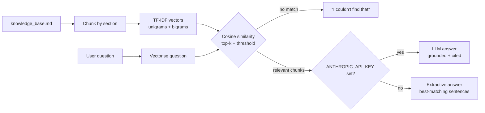

# 📚 RAG Q&A Assistant — Retrieval-Augmented Generation from scratch

> A question-answering assistant that answers staff questions from a company handbook, **grounded in retrieved sources** — built from first principles with scikit-learn, with optional LLM generation via the Claude API.


## Overview

**Problem:** Retail staff constantly need quick answers on returns, lay-by, rosters and store policy — but handbooks are long and nobody reads them.

**Solution:** A RAG pipeline that finds the relevant handbook sections for a question and answers **only from those sections**, citing where the answer came from. If nothing relevant is found, it says so instead of making something up.

> ℹ️ The knowledge base (`knowledge_base.md`) is a **fictional** staff handbook for a made-up store, "Harbour Threads".

## Demo

```text
$ python rag.py "Can I get a cash refund on a sale item?"
Q: Can I get a cash refund on a sale item?
A: Sale items are not eligible for a cash refund unless they are faulty.
Sources: [('Sale item returns', 0.481), ('Faulty items', 0.174), ('Cash handling', 0.075)]

$ python rag.py "Do you sell laptops?"
Q: Do you sell laptops?
A: I couldn't find that in the knowledge base.
Sources: []
```

## How it works



| Stage | Choice | Why |
|---|---|---|
| Chunking | One chunk per `##` section | Sections are self-contained topics |
| Retrieval | TF-IDF + cosine similarity | Fast, transparent, zero cost, runs offline |
| Guardrail | Minimum similarity threshold | Refuses out-of-scope questions instead of hallucinating |
| Generation | Claude API (optional) or extractive | Works with or without an API key |

## Evaluation

Retrieval quality was measured on 12 hand-labelled questions, deliberately **phrased differently** from the handbook text (`python evaluate.py`):

| Metric | Score |
|---|---|
| Hit@1 (correct section ranked first) | **0.75** |
| Hit@3 (correct section in top 3) | **0.92** |
| MRR (mean reciprocal rank) | **0.84** |

**Error analysis:** the misses show the main weakness of keyword-based retrieval. *"My jacket's zip broke"* never uses the word **"faulty"**, so TF-IDF can't connect them (rank 9). This is exactly the gap that **dense semantic embeddings** close, and it is the next planned upgrade.

## Getting started

```bash
git clone https://github.com/sanjana29-1/rag-qa-assistant.git
cd rag-qa-assistant
pip install -r requirements.txt
python rag.py "How long are gift cards valid?"
python evaluate.py

# Optional: LLM-generated, cited answers
pip install anthropic
export ANTHROPIC_API_KEY=your_key_here
python rag.py "What happens if I cancel my lay-by?"
```

## Project structure

```
├── rag.py              # chunking, retriever, answer generation
├── evaluate.py         # Hit@k / MRR retrieval evaluation
├── knowledge_base.md   # fictional sample handbook
└── requirements.txt
```

## Roadmap

- [ ] Swap TF-IDF for **sentence-transformer embeddings** and compare metrics
- [ ] **Hybrid search** (BM25 + dense) with re-ranking
- [ ] Store vectors in a **vector database** (FAISS / Chroma)
- [ ] **Streamlit** chat UI
- [ ] Evaluate answer faithfulness, not just retrieval

---
👩‍💻 **Sanjana Raj** · AI & Data graduate, Macquarie University · sanjana292001@gmail.com
